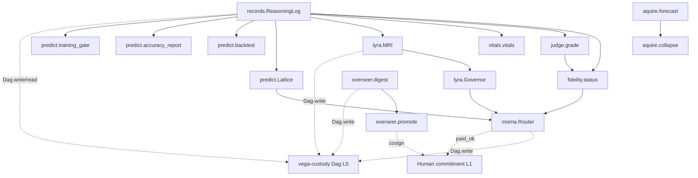

# vega-reasoning-sdk — Architecture

## 1. The organism (family picture)

```
                 ┌──────────────────────────┐
                 │   THE HUMAN (the owner)  │  holds the only signing key;
                 │  authority starts here   │  spends it one action at a time
                 └────────────┬─────────────┘
                              v single-use signed commitments
 15 assemble   vega-umbrella-sdk        the family as one organism: one keyed
                                        ledger, one approval check, one anchor,
                                        registry + pre-deploy audit
 14 deliberate vega-council-sdk         multi-brain deliberation, design-first builder
               vega-galaxy-sdk          the galaxy view of the knowledge lattice:
                                        levels, convergence, futures above the present
 13 watch      vega-governance-feed-sdk  live view of every chain + tamper alarms
 12 verify     vega-metacog-sdk          evidence rungs and the completion gate
 11 reason  >>> vega-reasoning-sdk <<<   fidelity, forecasting, routing: the lattice
                                        that predicts steps ahead
 10 observe    vega-trace-sdk            telemetry of reasoning: layer traces, entropy,
                                        harmonic echo, reference signature
  9 interface  vega-terminal-sdk         gated command execution for people and agents
  8 learn      vega-train-sdk            governed training + freeze cards: records
                                        exactly what a model learned from
  7 knowledge  vega-dkg-lattice-sdk      the knowledge graph: every fact with origin
                                        and licence; repo-library processing
  6 conduct    vega-harness-sdk          deterministic workflow conduct, pre-registered
                                        predicted paths, library use gate
  5 memory     vega-librarian-sdk        lessons and memory of past incidents
  4 contain    vega-two-gate-sdk         containment between two gates + the hard stop
  3 adapt      vega-pareah-sdk            adapters, cards, quarantine of inbound code:
                                        the dead-end room for the unannounced
  2 seal       vega-superproof-sdk       layered sealing and proof tiers
  1 authority  vega-governance-jacket-sdk human-only actions, single-use signed
                                        commitments, entry and exit gates
  0 record     vega-custody-sdk          capsules, DAG, hash-chained ledger, safe paths,
                                        bounded processes — the foundation everything
                                        writes to
```

**What layers below provide:** Layer 0 (custody) supplies the append-only hash-chained Dag (`vega_custody.dag.dag.Dag`) that every record in this SDK writes to and reads from. The Dag guarantees tamper-evidence, verification, and that texts never reach the chain (only hashes).

**Who above consumes:** Layer 10 (trace) reads reasoning records for telemetry. Layer 12 (metacog) uses fidelity/vitals for evidence rungs. Layer 14 (galaxy) consumes lattice forecasts for the galaxy view. Layer 15 (umbrella) registers this SDK as layer 11 with `requires=["custody"]`.

**One family, one organism:** every SDK owns exactly one concern and uses the owner of every other concern instead of growing its own copy.

## 2. Internal drawing (ASCII box diagram)

```
┌─────────────────────────────────────────────────────────────────────────────┐
│                            vega-reasoning-sdk (layer 11)                    │
│  ┌─────────────┐  ┌──────────────┐  ┌────────────┐  ┌──────────────────┐   │
│  │  records    │──│   fidelity   │──│   judge    │  │     vitals       │   │
│  │  (Log/Dag)  │  │  (gate)      │  │  (compare) │  │  (GREEN/AMBER/   │   │
│  │             │  │              │  │            │  │   RED health)    │   │
│  └──────┬──────┘  └──────┬───────┘  └──────┬─────┘  └────────┬─────────┘   │
│         │                │                 │               │             │
│         │                ▼                 │               │             │
│         │         ┌─────────────┐          │               │             │
│         │         │    morna    │◄─────────┘               │             │
│         │         │  (router)   │                          │             │
│         │         └──────┬──────┘                          │             │
│         │                │                                 │             │
│         ▼                ▼                                 ▼             │
│  ┌─────────────┐  ┌──────────────┐  ┌────────────┐  ┌──────────────┐   │
│  │    lyra     │  │   aquire     │  │  overseer  │  │   predict    │   │
│  │ (MRI + Gov) │  │ (forecast)   │  │ (digest)   │  │  (lattice)   │   │
│  └──────┬──────┘  └──────┬───────┘  └──────┬─────┘  └──────┬───────┘   │
│         │                │                 │               │             │
│         └────────────────┴─────────────────┴───────────────┘             │
│                              │                                            │
│                              ▼                                            │
│                     ┌────────────────┐                                    │
│                     │ vega-custody   │                                    │
│                     │    Dag (L0)    │                                    │
│                     └────────────────┘                                    │
└─────────────────────────────────────────────────────────────────────────────┘
```

**Authority flow (human → model → world, never model → authority):**
- Human signs commitment → `paid_ok`/`cosign` verify it → paid lane runs / overseer promotes
- Fidelity gate checks record → allows apprentice lane only when promoted
- Training gate checks restriction → refuses commercial use of frontier-derived records

**Data/knowledge flow (record → lattice → human):**
- `records` → `fidelity`/`vitals`/`predict` → lattice forecast → human decision
- `records` → `lyra.MRI` → feature attribution → difficulty governor → routing depth
- `records` → `morna` frozen cache → zero-recompute repeat calls

## 3. Mermaid version



## 4. Sequence: main scenario (route a query end to end)

```
USER QUERY
    │
    ▼
┌──────────────────────────────────────┐
│ morna.Router.route(task_class, query)│
└──────────────────────────────────────┘
    │
    ▼
┌──────────────────────────────────────┐
│ 1. Check frozen cache                │
│    key = (lane_name, sha256(query))  │
│    HIT → return result, MORNA_RECALL │
└──────────────────────────────────────┘
    │ MISS
    ▼
┌──────────────────────────────────────┐
│ 2. fidelity.status(rows, task_class) │
│    → promoted? want="apprentice"     │
│    → NOT promoted? want="reference"  │
└──────────────────────────────────────┘
    │
    ▼
┌──────────────────────────────────────┐
│ 3. Candidate lanes = lanes where     │
│    task_class in classes AND role==want│
│    Sorted by cost: free > local > paid│
└──────────────────────────────────────┘
    │
    ▼
┌──────────────────────────────────────┐
│ 4. For each lane in order:           │
│    IF cost=="paid" AND NOT           │
│       paid_ok(lane, sha256(query))==True:│
│       record MORNA_SKIP, continue    │
│    TRY lane.call(query)              │
│    IF exception OR non-text result:  │
│       record MORNA_FAIL, continue    │
│    ELSE: freeze result, record       │
│         MORNA_CALL, return           │
└──────────────────────────────────────┘
    │
    ▼
┌──────────────────────────────────────┐
│ 5. No lane succeeded → return        │
│    {ok: False, attempts: [...]}      │
└──────────────────────────────────────┘
```

**Authority checkpoints (fail-closed):**
- Step 1: Cache hit returns frozen result (no recompute, no authority needed)
- Step 2: Fidelity gate — apprentice only if promoted (record-backed)
- Step 4: `paid_ok` must return exactly `True` (human commitment verified per query)
- Step 4: Lane crash/non-text → fall through (never returns garbage)

## 5. Trust boundaries

| Boundary | What changes hands | Enforcement |
|---|---|---|
| Human → SDK | Single-use signed commitment (paid_ok, cosign) | Caller wires `paid_ok(lane, query_hash)` and `cosign(verdict_hash)` to governance jacket; SDK only checks return is exactly `True` |
| Model → Record | Reasoning text (query/trace/answer) | `records.make` hashes texts immediately; only SHA-256 digests reach Dag |
| SDK → Custody (L0) | Record payloads (hashes, scores, labels) | `ReasoningLog.add` → `Dag.record`; `Dag.verify()` validates chain integrity |
| Fidelity gate → Routing | Promotion decision (apprentice vs reference) | `fidelity.status` computes Wilson+CUSUM; `fidelity.route` denies apprentice when not promoted |
| Training gate → Downstream | Row eligibility for training | `predict.training_gate` refuses restricted rows for non-personal-research purposes |
| Overseer → Human | Candidate verdict (NOURISHING/SICK/HUNGRY) | `overseer.promote` requires `cosign(verdict_hash) is True`; SDK never signs |
| Lyra MRI → Governor | Feature→flag associations | `MRI.attribute` returns `clear` flag (|diff| > 95% half-width); association, not causation |

## 6. Fail-closed workflow diagram (computational)

```
┌─────────────────────────────────────────────────────────────────────────────┐
│                        FAIL-CLOSED CONSTRAINT POINTS                        │
├─────────────────────────────────────────────────────────────────────────────┤
│                                                                             │
│  INPUT VALIDATION (all modules)                                             │
│  ┌─────────────────────────────────────────────────────────────────────┐   │
│  │ records.make()          → RecordRefusedError on bad field           │   │
│  │ ReasoningLog.add()      → RecordRefusedError on bad record          │   │
│  │ judge.grade()           → JudgeRefused on bad judge output          │   │
│  │ lyra.MRI.observe()      → LyraRefused on bad features/outcome       │   │
│  │ lyra.Governor.step()    → LyraRefused on difficulty ∉ [0,1]         │   │
│  │ aquire.forecast()       → AquireRefused on bad graph/params         │   │
│  │ aquire.collapse()       → AquireRefused on bad outcomes/reqs        │   │
│  │ morna.Lane()            → MornaRefused on bad definition            │   │
│  │ morna.Router.route()    → MornaRefused on bad task_class/query      │   │
│  │ overseer.digest()       → OverseerRefused on bad build/test         │   │
│  │ overseer.promote()      → OverseerRefused on bad verdict            │   │
│  │ predict.Lattice()       → PredictRefused on bad outcome             │   │
│  │ predict.training_gate() → PredictRefused on bad purpose             │   │
│  └─────────────────────────────────────────────────────────────────────┘   │
│                                                                             │
│  GATE DECISIONS (deny-default)                                              │
│  ┌─────────────────────────────────────────────────────────────────────┐   │
│  │ fidelity.status()     → promoted=False if n<30 OR Wilson<0.80       │   │
│  │                       OR cusum_alarm=True                           │   │
│  │ fidelity.route()      → "reference_required" when not promoted      │   │
│  │ judge.grade()         → combined_verified=False if trace OR         │   │
│  │                       answer not verified                           │   │
│  │ vitals.vitals()       → health="AMBER" if n<20; "RED" if drift      │   │
│  │                       OR Wilson<0.5; never GREEN on small n         │   │
│  │ morna.Router.route()  → paid lane SKIPPED unless paid_ok is True    │   │
│  │                       (crash → False); failures fall through        │   │
│  │ overseer.promote()    → "PROPOSED" unless cosign is True;           │   │
│  │                       SICK/HUNGRY never promote                     │   │
│  │ predict.Lattice.predict() → probability=None, basis="NO BASIS"      │   │
│  │                       when no cell has records                      │   │
│  │ predict.training_gate() → allowed=False for restricted rows         │   │
│  │                       + non-personal-research purpose               │   │
│  │ aquire.collapse()     → "AMBIGUOUS" (multi) / "NONE" (zero)         │   │
│  │                       unless exactly ONE survivor                   │   │
│  └─────────────────────────────────────────────────────────────────────┘   │
│                                                                             │
│  RECORD INTEGRITY (custody chain)                                           │
│  ┌─────────────────────────────────────────────────────────────────────┐   │
│  │ ReasoningLog.verify() → delegates to Dag.verify()                   │   │
│  │ Any tamper breaks chain hash → verify() returns False               │   │
│  │ Training restriction hashed on chain; local edit to None            │   │
│  │   does not affect recorded version (redteam_1:test_an_edited_      │   │
│  │   restriction_is_not_honoured_by_silence)                           │   │
│  └─────────────────────────────────────────────────────────────────────┘   │
│                                                                             │
└─────────────────────────────────────────────────────────────────────────────┘
```

**Module + function for each fail-closed point:**
- `records.make` / `ReasoningLog.add` (records.py) — input validation
- `fidelity.status` / `fidelity.route` (fidelity.py) — promotion/routing gate
- `judge.grade` (judge.py) — combined verification gate
- `vitals.vitals` (vitals.py) — health color gate
- `lyra.MRI.observe` / `lyra.Governor.step` / `lyra.Governor.difficulty` (lyra.py) — input validation + depth cap
- `aquire.forecast` / `aquire.collapse` (aquire.py) — input validation + collapse gate
- `morna.Lane.__init__` / `morna.Router.route` (morna.py) — lane validation + paid gate + fall-through
- `overseer.digest` / `overseer.promote` (overseer.py) — digest validation + co-sign gate
- `predict.Lattice.predict` / `predict.training_gate` / `predict.backtest` (predict.py) — NO BASIS gate + training gate
- `ReasoningLog.verify` (records.py) → `Dag.verify` (vega-custody-sdk) — chain integrity