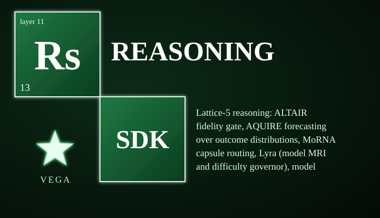

# vega-reasoning-sdk

Lattice-5 reasoning: ALTAIR fidelity gate, AQUIRE forecasting over outcome distributions, MoRNA capsule routing, Lyra (model MRI and difficulty governor), model vitals, the Overseer, and lattice prediction of accuracy from recorded history.

> **Licensing.** Source-available, not open source. Free for personal use; free for registered small businesses (under US$1M revenue and valuation); everyone else needs a commercial license (see LICENSE; for a commercial license write to jasonblasiak.ai.mail@gmail.com). Patent pending. Draft licence text, not yet reviewed by an attorney.

Package: `vega_reasoning` (src layout). Depends on: vega-custody-sdk.

## Modules

| Module | What it does |
|---|---|
| `records` | Hash-only record of every graded exchange (reference, apprentice, frontier); ground truth kept apart from fidelity. |
| `fidelity` | Promotion by Wilson lower bound with drift demotion, per task class. |
| `judge` | Trace and answer must BOTH match; a lexical stand-in judge with a negation check; real judges plug in. |
| `vitals` | GREEN, AMBER or RED per model; small samples never green. |
| `lyra` | Model MRI (association of prompt features with behaviour change) and a difficulty governor that rises fast and falls slowly. |
| `aquire` | Quantum-INSPIRED, classical: beam search and Viterbi over outcome graphs; collapse only when the requirements leave exactly one. |
| `morna` | Dormant capsule lanes, cheapest-capable routing, frozen results, paid lanes only with a verified commitment. |
| `overseer` | Digest a candidate by test (NOURISHING, SICK, HUNGRY); only a human co-sign promotes. |
| `predict` | Nested lattice forecast with shrinkage, walk-forward backtest, accuracy report, training-use gate. |

## What it does NOT do (read this)

- Promoted means matches the reference on the tested distribution, not frontier quality; the reference's mistakes are inherited.
- AQUIRE makes no quantum claim of any kind.
- Frontier-derived records carry a personal-research-only restriction and the training gate refuses other purposes.

## Status

See STATUS.md. Tests: 91 tests in 4 files, all passing.  See SECURITY.md for the threat model.

## Run the tests

Put `src` of this repo and of the repos it depends on on PYTHONPATH, then run each file in `tests/`.
